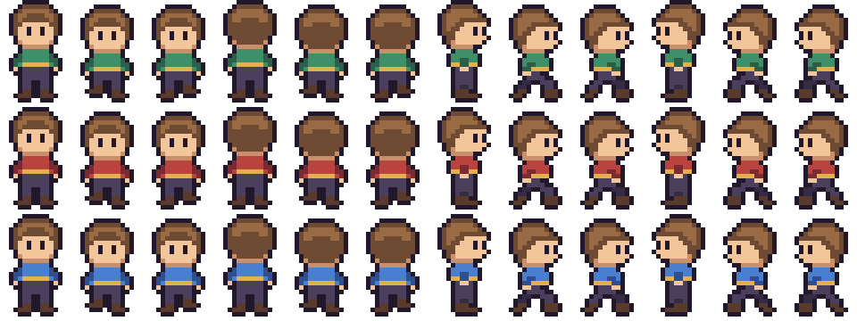
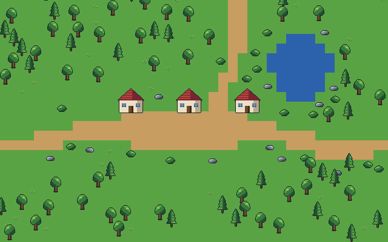
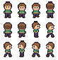
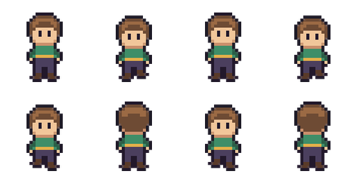

# Agent Sprite Forge Functional Validation (2026-10-30)

> Scope: isolated Windows `E:\GameAssetToolLab_20261023\ASF_Test_20261030`, upstream git commit `5324342fdfab72430f4e9604f3fe427009f8596d`. These screenshots are generated by the upstream **codeart2d** example specifications and synthetic locally generated video. They are **not** AI-image/video model outputs and **not** FS art acceptance.

## Screenshots

**A. 3 color variants x 12 distinct 16×24 top-down actor frames**: 


**B. 640×400 meadow map (40×25 cells x 16px; code-drawn, not FS-approved art)**:


**C. Actual Aseprite atlas from exporter**:


**D. Video frame recovery pipeline (offline synthetic MP4, 8 sampled PNG frames)**:


## Results, facts and warnings

| Function | Test evidence | Result |
|---|---|---|
| Environment | Windows device online; Python 3.11, Pillow 12.3, NumPy 2.4.6; FFmpeg 9.0.2 | READY for offline branches |
| AI media generation | forge_doctor: no image/video API key, Codex CLI or Grok CLI configured in this Windows environment | **NOT AVAILABLE**. No charged API calls were made |
| Code-drawn actor | `render_pixelspec.py`, 3 variants forest/crimson/sky, 12 frame names each; strict QC no failed checks | **PASS WITH WARN**: half-cycle duplicates on walk_down/up/right, some IoU 0.99–1.0 |
| Animation clips / engine export | 4 walk direction clips, 12 unique frames total, Aseprite JSON + Godot SpriteFrames / Sprite3D Atlas emitted and parse-verified | **EXPORT PASS; Godot 4.7.2 editor import and headless scene load PASS; motion visual review PENDING** |
| Playable map | `layout_build.py` produced 640×400 map, 123 objects, 104 solids, 41 collision rectangles, 3 exits, initial 6/6 navigation targets reachable | **TECH PASS; ART FAIL against FS style** |
| Navigation / collision | `map_bundle.py validate`: 0 errors/warnings. `map_nav.py check`: no unreachable targets or thin gaps, 10 unreachable walkable pockets (18 cells), reciprocal exit links skipped | **WARN / NOT FORMAL PASS** |
| Tiled | `export_tiled.py` generated TMJ layers ground,props,collision,interactions; exporter self-test pixel diff 0 | **EXPORT PASS** |
| Godot | `export_godot.py`: scene with 123 objects and assets; tested Godot 4.7.2 editor import then launched --headless --quit-after 5 (exit 0) | **NATIVE SCENE LOAD PASS**, no on-screen game screenshot or player collision test |
| Supplied video → transparent sprite | Generated **synthetic** local MP4 from walker frames; `video2dsprite.py process` decoded 16 frames and sampled 8; generated GIF and strip | **PASS WITH WARN**: soft matte may key character design color near magenta |
| Real AI image-to-video / 6 actions | AI routes missing; only synthetic video tested; no identity-preserving master still animation | **NOT TESTED** |
| FS high-detail Ground/PAR | This code-drawn map has cartoon placeholder surfaces, and cannot satisfy R17 high-detail art; explicit ground/PAR semantic integration not run | **NOT TESTED / ART NOT ACCEPTED** |
| Full upstream tests | `pytest` not installed in system Python; no full test suite | **NOT RUN** |

## Repro paths (no project sealed files touched)

```text
E:\GameAssetToolLab_20261023\ASF_Test_20261030\doctor.json
E:\GameAssetToolLab_20261023\ASF_Test_20261030\walker-full\
E:\GameAssetToolLab_20261023\ASF_Test_20261030\walker-engine\
E:\GameAssetToolLab_20261023\ASF_Test_20261030\meadow-map\
E:\GameAssetToolLab_20261023\ASF_Test_20261030\map-nav\
E:\GameAssetToolLab_20261023\ASF_Test_20261030\map-tiled\
E:\GameAssetToolLab_20261023\ASF_Test_20261030\map-godot\
E:\GameAssetToolLab_20261023\ASF_Test_20261030\video-fixture\
E:\GameAssetToolLab_20261023\ASF_Test_20261030\video-processed\
```

## Decision
Keep **Agent Sprite Forge** in the tool registry as a candidate supplemental sprite/scene postproduction pipeline. Do not replace R17 canonical Manifest, art quality acceptance, ground/PAR ownership, occlusion/collision or sealed VX runtime. The next meaningful trial requires an approved character image or actual model route for six actions and a rich consistent FS map art kit, followed by actual VX/Godot gameplay screenshots and strict visual review.
