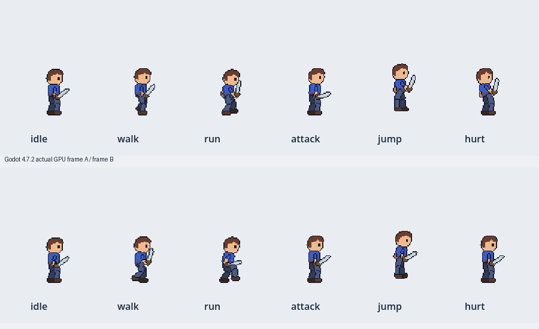
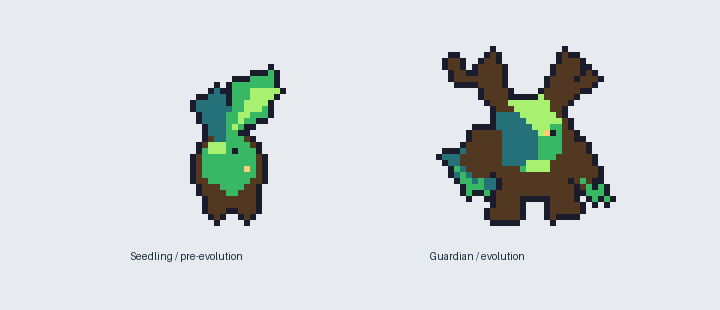
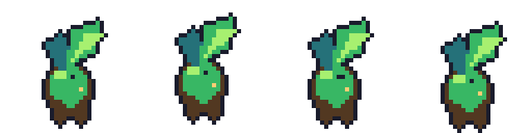
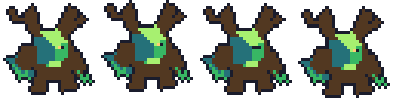

# Agent Sprite Forge | 2026-10-31 six-action and species-evolution functional test

**STATUS: ISOLATED CODE-ART & GODOT TECHNICAL PASS / ART STYLE PENDING / NO MODEL-GENERATED MOTION.**

Upstream: https://github.com/0x0funky/agent-sprite-forge (pinned checkout `5324342fdfab72430f4e9604f3fe427009f8596d`). Only the test workspace `E:\GameAssetToolLab_20261023\ASF_Test_20261031` was modified. No sealed Forest Symphony, PMD, LPC or CG game assets or runtime scripts were changed. This branch is test-only.

## Actual image evidence



**Six animation states from ONE canonical SVG rig, with the blade attached to the forearm:** idle (4), walk (8), run (8), attack (7), jump (9), hurt (6). Total 42 logical frame slots deduplicate to **37 unique PNGs**, 64x64 RGBA, fixed anchor [32,59]. Each clip uses the same original rig and weapon geometry, not independently redrawn AI images. `rig_animate.py --backend resvg_py --route pixel --build-clips --strict-qc` PASS, all 12 QA checks PASS including alpha/palette/outline, walk/idle/run seams (0.9761/1.0018/0.9311), planted foot drift 0, 0 IK clamps, 0 ground-row failures, 0 margin failures. Initial jump frame 4 reached edge (strict **FAIL**); vertical travel reduced and the whole suite rerun **PASS**. Original generated candidate retained locally as negative regression evidence.

The resulting Aseprite JSON and Godot SpriteFrames/Sprite3D pack passed tool export. **Actual AMD Radeon RX6700XT OpenGL / Godot 4.7.2** rendered 900x260 scene after real editor import. In first render an integration bug masked all six animations: `play(action)` was called before `add_child()` and the PackedScene's autoplay overwrote it. The test fixed the call order, recaptured two frames and quantified pixel changes by 120px character region:

| Action | Changed RGB pixels in GPU frame A vs B |
|---|---:|
| idle | 460 |
| walk | 1034 |
| run | 1247 |
| attack | 653 |
| jump | 1236 |
| hurt | 1217 |

`qa/godot_animation_diff.json` stores measurements, native rendered combined PNG above, `engine/` contains a reproducible Godot 4 test project and exported Scene/SpriteFrames/atlas. **Engine movement demonstrated; VX native integration NOT RUN, human art Gate F PENDING.** A working native scene is still an artistically basic puppet. Attack arc and 3/4 multi-facing artwork need production refinement.

## Monster evolutionary forms, *not* mere hue swap



Shared palette/ink and 32x32 fixed canvas. Thornkin **seedling** is a small plant-sprout body, 277 opaque pixels; Thornkin **guardian** is a broad walking wooden creature with branch antlers, arms, claws, legs, leaf-tail and 537 opaque pixels. Silhouette IoU **0.4614**, area ratio guardian/seedling **1.9386**. Both were authored by local Python PixelSpec builders, **no AI model**, 4 unique idle poses each, and both `render_pixelspec --build-clips --strict-qc` completed with zero failures/warnings after modifying a guardian antler corner (original guardian FAIL: 11 L corners >10; corrected re-render 10 or fewer). Both Aseprite/Godot export passes are parse-level, Godot *native monster gameplay* remains unverified. The species are deliberately visibly different yet **NOT** PMD reference-art quality.




## Files and replay

`source/` contains the Python deterministic authors, canonical SVG, ready-to-use minified animation and both species specs. `engine/` contains the fully self-contained Godot scene, SpriteFrames, PNG texture, project file and GPU screenshot script. The monster exports reside in `engine-monsters/`, QA in `qa/`.

Original full Windows ZIP: `E:\GameAssetToolLab_20261023\ASF_Test_20261031\ASF_SIX_ACTIONS_EVOLUTION_20261031.zip`: 202 files, 942,713 bytes, CRC valid, SHA256 `b9c5575ddadd927757f6d5cf08fede9faffec8dcbf77751004c3702ae57b5b30`. **This ZIP is local to the connected Windows computer and is NOT claimed uploaded to Drive/GitHub.** This repository folder holds portable selected sources/art/screenshots/QA and can be used to reproduce.

Basic replay on the pinned upstream skills Python environment:

```powershell
# Run make_six_actions.py and make_monsters.py from source after installing upstream tools.
$env:PYTHONPATH = "E:\GameAssetToolLab_20261023\ASF_Test_20261031\vendor"
python E:\GameAssetToolLab_20261023\ASF_SkillRegistry_20261030\codeart2d\scripts\rig_animate.py --anim E:\GameAssetToolLab_20261023\ASF_Test_20261031\source\six-actions.anim.json --output-dir E:\GameAssetToolLab_20261023\ASF_Test_20261031\NEW_OUT --backend resvg_py --route pixel --build-clips --strict-qc
```

**No true AI image or image-to-video model generation route was configured on remote Windows** in the earlier `forge_doctor` check. This does **not** substantiate the original social-media claim of generating six model-based action clips from one drawn character. We tested the *offline rig and sprite export pipeline* with real engine integration. R17 Ground/PAR remains in its own development branch and is unaffected.

### Acceptance decision

Keep tool as a controlled **animation/exports technical helper**. To graduate to game production, test actual art masters and model-backed clips, four-facing VX-sized assets, original PMD species anatomy readability, real native VX runtime/weapon alignment and R17 Ground/PAR reference-art accuracy. Record real art or runtime failures rather than converting technical passes into visual approval.
